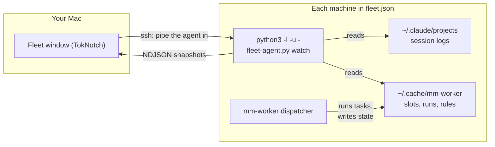

# Fleet

Fleet is what this fork of TokNotch adds to the original app. TokNotch sits at
the edge of your screen and shows what your AI plans have paid back on one Mac.
Fleet extends that to several machines: a window that watches the agents on
every machine you list — their Claude Code sessions, their `mm-worker` tasks,
today's tokens — and edits each machine's worker dispatch rules from one place.

It is for people who run coding agents on more than one machine: a Mac and a
Linux workstation, a headless box in a cupboard, a single-board computer on a
shelf. Nothing needs installing on the machines being watched, and each machine
keeps working when your Mac is off.

The dispatch rules themselves and the on-disk state layout are specified in
[FLEET-RULES.md](FLEET-RULES.md); this page links to it rather than repeating
it. This guide is also available in
[Simplified Chinese](FLEET.zh-CN.md).

## Features

- **Overview page** — across all machines: how many are online, active
  sessions, workers running, tokens today; a card per machine; provider
  totals against optional account limits.
- **Each machine's page** — online state, CPU use, load average, CPU
  temperature, today's tokens by model, and the sessions on it. There is
  no GPU monitoring.
- **Usage page** — token use across machines and accounts, for today, 7 days or
  30 days, viewed by machine, account or model, with or without cache reads: a
  total, the change against the previous period, daily stacked bars and a
  breakdown you can unfold. History is cached on the Mac, so an offline machine
  still counts and says when it last reported. See
  [FLEET-USAGE.md](FLEET-USAGE.md).
- **Live worker progress** — name, provider, model, step, the tool running
  now, the file it last touched, tokens, and how long it has been quiet. A
  stop button with a confirmation.
- **Per-machine rules editor** — enabled providers, slots, the model for each
  task level, balance mode, provider order, default timeout, cooldown, and a
  reset to the defaults. A save that would overwrite someone else's change is
  refused.
- **Install or update the dispatcher from the app** — the bundled
  `mm-worker.py` is sent over ssh to `~/.local/bin/mm-worker`.
- **Provider totals with account limits** — each provider's running workers
  and slots added up across machines, with an optional per-account limit and
  a warning when the slots add up to more. The warning is all it is: each
  machine limits itself, and nothing enforces the limit across machines.
- **mm-worker** — a Python dispatcher that runs Claude Code tasks on several
  providers: task levels, per-provider slots, failover with cooldown, and
  tasks sent to another machine with `-H`.
- **Remote usage sync** — a button that runs your own
  `~/bin/tokscale-remote-sync` script, if you have one, so the rings count
  the other machines' usage too.

## How it works

TokNotch pipes a small agent, `fleet-agent.py`, into `python3 -I -u -` over
ssh on each connection. The agent reads Claude Code's session logs and
mm-worker's state folder, and prints one JSON snapshot per line. Nothing is
installed on the machine being watched, and the agent always matches the app,
because the app brings its own copy. When the connection ends, the agent's
next write fails and it exits by itself.



- **Nothing is installed to be watched.** The agent arrives on stdin and
  runs with `-I`, so Python imports nothing from the remote home folder.
- **Connections run only while the window is open.** Opening the Fleet
  window starts them; closing it stops them. A machine nobody is looking at
  costs nothing.
- **Commands are one-shot connections.** Stopping a worker, saving or
  resetting rules, and installing the dispatcher each run one command and
  finish; they are not the long-lived watch.
- **Each machine's rules live on that machine**, in
  `~/.config/mm-worker/rules.json`. Nothing coordinates machines at run
  time, so a machine keeps dispatching with the Mac powered off. See
  [FLEET-RULES.md](FLEET-RULES.md).

The ssh connection uses `BatchMode`, so it never stops to ask for a password:
a machine without key-based login shows as offline.

## Requirements

**Your Mac**

- macOS 14 (Sonoma) or newer.
- Python 3, for watching this Mac itself. The app looks for `python3` in the
  usual places, including Homebrew.
- To build: Xcode and [xcodegen](https://github.com/yonaskolb/XcodeGen). The
  fork was built and tested with Xcode 26.6 on macOS 15.6.1.

**Each machine you add**

- Linux or macOS.
- Python 3.9 or newer. Nothing else: the agent is standard library only.
- Key-based ssh from your Mac, as the user TokNotch connects as. Password
  prompts are never shown.
- For `mm-worker` to run tasks there: Claude Code, installed and logged in on
  that machine.

## Build and install from source

There is no release of this fork. Source is the only way to get Fleet.

```sh
brew install xcodegen
make run
```

The first build fetches the pinned tokscale binary and generates the Xcode
project; then a Debug build is launched. `make test` runs the Swift test
suites, including the GUI-hosted ones. The Python suites run on their own — see [Testing](#testing).

`make install` builds a Release app straight into `/Applications`, signed with
the **upstream author's** Developer ID. That signature is not yours, so it
will not work for anyone else; this fork has no signing identity of its own.

## Configuration

### The fleet list

Machines are listed in `~/.config/toknotch/fleet.json` on your Mac, outside
the repository, so machine names never end up in the source. Without the file
— or with an unreadable one, or an empty `devices` — the fleet is just this
Mac. Listing devices replaces that default, so include this Mac as an entry
with an empty `ssh` list if you want to see it too.

```json
{
  "devices": [
    { "id": "local", "label": "This Mac", "ssh": [] },
    {
      "id": "workstation",
      "label": "Workstation",
      "ssh": ["workstation", "workstation-vpn"]
    },
    {
      "id": "raspberry",
      "label": "Board",
      "ssh": ["raspberry"],
      "sudoUser": "agentuser"
    }
  ],
  "accountLimits": { "minimax": 10, "zhipu": 4 }
}
```

| Field | Meaning |
|---|---|
| `id` | Unique name for the machine, used internally. |
| `label` | What the window shows. Optional; defaults to `id`. |
| `ssh` | ssh aliases (from your `~/.ssh/config`), tried in order. Empty means this Mac. On a failure the app moves to the next alias, then backs off. |
| `sudoUser` | Read this other account's data through passwordless sudo (`sudo -n -u … -H`). Its rules then stay read-only. |
| `accountLimits` | Per provider, the most slots the account allows. Positive integers; used only for the totals warning. |

Editing the file by hand needs an app restart to take effect. The one
exception is account limits: a limit typed into the Provider totals table in
the window is saved by the app into this file, and takes effect at once.

### Provider keys

`mm-worker` reads each provider's host and key from a file on the machine
that runs the work, in the form `NAME=value`, one per line:

| Provider | File | Variables |
|---|---|---|
| MiniMax | `~/.config/minimax/env` | `MINIMAX_API_HOST`, `MINIMAX_API_KEY` |
| Zhipu | `~/.config/zhipu/env` | `ZHIPU_API_HOST`, `ZHIPU_API_KEY` |
| Qwen | `~/.config/qwen/env` | `QWEN_API_HOST`, `QWEN_API_KEY` |
| Claude | — | No file. Claude Code must be installed and logged in on that machine. |

Each file may also override the model an alias stands for (`MM_OPUS`,
`MM_SONNET`, `MM_HAIKU`, `ZP_OPUS`, `ZP_SONNET`, `ZP_HAIKU`, `ZP_SUBAGENT`,
`QW_OPUS`, `QW_SONNET`, `QW_HAIKU`, `QW_MAX_OUTPUT`, `QW_SUBAGENT`); see
`provider_env()` in `Sources/Resources/mm-worker.py` for how they are used.

Fleet never reads, copies or shows these values — see
[Security and privacy](#security-and-privacy).

## Using the Fleet window

### Opening it

All of these open the same window:

- the settings window — the **Fleet…** row at the foot of the sidebar, under
  the page list (设备与 Agent… in the Chinese interface);
- right-clicking the Dock icon, if TokNotch is in the Dock;
- the app menu — **Fleet…**, with ⇧⌘F;
- the menu bar icon's panel — the **Fleet…** row;
- the notch's right-click menu — the **Fleet…** entry.

Opening the window starts the connections; closing it stops them. Rules you
were editing but had not saved survive a closed window.

### Overview

The first page adds the fleet up: online machines out of the total, active
sessions, workers running, and tokens today. Each machine is a card with its
state, CPU use, temperature, and its own three numbers; click one to open its
page. Under the cards, **Provider totals** adds each provider up across
machines — running workers, configured slots, and the account limit you may
set there — and warns when the slots add up to more than the limit allows.

### A machine's page

The header names the machine, its hostname, system and architecture, load
average, and which ssh alias served the report — or why it is offline, and
when it was last heard from. Then:

- **Stat tiles** — CPU use and temperature, coloured as they warm up; tokens
  today; active sessions; workers running.
- **Today by model** — a bar per model, sized by its share of today's tokens.
  Hovering shows input, output, cache read and cache write.
- **Workers** — one row per running or recently finished `mm-worker` task:
  the name given with `-n`, provider, model, state, the step it is on, the
  tool running now and the file it last touched, tokens, and elapsed time. A
  worker that has been quiet for five minutes says so. The stop button asks
  first: *Stop this worker?* — a stopped task is not retried on another
  provider, and its work may be left half done. A task dispatched from this
  machine to another one is listed on the machine that runs it, so it is
  counted once and can be stopped only there.
- **Sessions** — Claude Code sessions, interactive and worker, busiest
  activity first, from the last six hours: title or project folder, kind,
  model, the tool running now, tokens, and whether the session is active.
- **Dispatch rules** — the editor described next.

### Dispatch rules

The rules editor at the foot of each machine's page edits that machine's
`~/.config/mm-worker/rules.json`. The field meanings are specified in
[FLEET-RULES.md](FLEET-RULES.md); the editor validates as you type and
refuses to save anything the machine would reject.

- **Providers** — a switch and a slot stepper per provider, with the number
  of slots in use, whether a key is configured on that machine, and a
  cooling-down notice with its reason.
- **Model for each level** — a menu per level and provider; *Don't use*
  leaves a provider out of that level. The menus list every model the provider's
  API reports, read once when the rules are shown and on demand. Claude's is a
  built-in list, as a subscription has no key to ask with. This needs that machine's
  `mm-worker` at version 2 or later. A level left with no enabled provider
  is called out, since only a task sent straight to a provider would run.
- **Balance** — *Proportional* (the provider using the smallest share of its
  slots; ties follow the order) or *Priority* (the first provider in the
  order with a free slot).
- **Provider order** — move up and down.
- **Default timeout** and **Cooldown**, in seconds.
- **Save**, **Revert**, and **Reset to Defaults…**, which asks first.

A save is refused when the machine's rules have moved on since you started
editing — say, another person or another Mac changed them. The window tells
you, shows the latest rules, and keeps nothing of what you typed; apply your
changes again. Offline machines show their last known rules, and keep unsaved
edits until the machine is back. A machine read through someone else's sudo
is read-only throughout.

Above the form, the dispatcher's own status is shown — not installed, older
version, up to date, or newer than this app — with an **Install…** or
**Update…** button that sends the bundled `mm-worker.py` over ssh to
`~/.local/bin/mm-worker`. The byte count is checked before the file is
renamed into place, so a dropped connection cannot install half a dispatcher,
and a dispatcher already running keeps its old copy until it exits.

## mm-worker usage

`mm-worker` runs one non-interactive Claude Code task on one of several
providers, chosen by task level and load, and moves to the next provider when
one runs out of quota or fails. It is standard-library Python 3.9 or newer,
Linux and macOS, and its full contract — rules format and state layout — is
[FLEET-RULES.md](FLEET-RULES.md).

### Commands

```sh
# Run a task, picking a provider by level and load
mm-worker "fix the failing tests"

# Name it (so it reads well in Fleet) and take a longer prompt from a file
mm-worker -n "api-client" -l hard -f task.md

# Pipe the prompt
echo "summarise these notes" | mm-worker

# Force a provider, even a disabled one
mm-worker -b zhipu "refactor the cache module"

# What this machine would use now, what is cooling, the last 15 runs
mm-worker --status

# Send a task to another machine; it survives losing the connection
mm-worker -H workstation -n "bench" "benchmark the parser"

# Collect or cancel it later, by the run id mm-worker printed
mm-worker --fetch 20260612-101502-4311
mm-worker --kill 20260612-101502-4311
```

The prompt comes from an argument, `-f file`, or stdin. Anything after `--`
is passed to Claude Code.

### Exit codes

| Code | Meaning |
|---|---|
| `0` | Success |
| `2` | Bad usage: unknown level, no or empty prompt, or — with `-H` — a target that is unreachable or lacks `mm-remote-run` |
| `3` | Refused: `mm-worker` was started inside another worker; nested dispatch is not allowed |
| `124` | The run timed out (a remote timeout is reported as `124` too) |
| `127` | Claude Code not found (local runs) |
| `130` | Cancelled or interrupted; the task is not retried on another provider |
| anything else | Failure; with automatic dispatch the task moves to the next provider |

### Options

| Option | Meaning |
|---|---|
| `-l, --level simple\|normal\|hard` | Task level (default `normal`, or `simple` with `-m fast`) |
| `-b, -P, --backend auto\|minimax\|zhipu\|claude\|qwen` | Force a provider, even a disabled one (default `auto`) |
| `-m, --mm-model m3\|m27\|fast\|full name` | MiniMax model |
| `-z, --zp-model flash\|full name` | Zhipu model |
| `-q, --qw-model glm\|max\|flash\|lite\|ds` | Qwen endpoint model |
| `-c, --claude-model MODEL` | Claude model (opus only for hard) |
| `-t, --timeout SEC` | Timeout for one run (default from the rules) |
| `-n, --name NAME` | Task name shown in Fleet |
| `-f FILE` | Read the prompt from a file |
| `-H, --host HOST` | Run the worker on another machine over ssh |
| `-C, --rdir DIR` | Working folder there (default: this one, relative to the home folder) |
| `--json` | Print the raw result event instead of its text |
| `--status` | Show cooling, slots and recent runs |
| `--fetch RUN_ID` | Fetch the result of a task sent to another machine |
| `--kill RUN_ID` | Cancel a task sent to another machine |
| `-h, --help` | The usage text |

Defaults for `-H`, `-C` and `-c` come from the environment variables
`MM_WORKER_HOST`, `MM_WORKER_RDIR` and `MM_WORKER_CLAUDE_MODEL`. Slots,
cooldown, poll interval and how long to wait out an unreachable target can be
overridden per environment too (`MM_WORKER_SLOTS_<PROVIDER>`,
`MM_WORKER_COOLDOWN`, `MM_WORKER_POLL`, `MM_WORKER_OFFLINE_WAIT`); see the
top of `mm-worker.py`.

A provider with no key on this machine is skipped by automatic dispatch;
forcing it with `-b` still reaches it, as a deliberate override.

### Running a task on another machine

`-H host` sends the task to `host` over ssh and watches it from here. The
prompt and, if given, the name are copied to
`~/.cache/mm-worker/jobs/<run id>-<provider>/` on the target, and the job is
launched detached from the connection, so losing the connection — or shutting
this machine — does not stop it. `mm-worker` retries while the target is
unreachable, tells you how to `--fetch` or `--kill` the task, and collects
the result when it can. The **dispatching** machine's slots and rules apply,
as the worker is counted where it was dispatched from; see
[FLEET-RULES.md](FLEET-RULES.md).

`-H` needs a companion script, `~/.local/bin/mm-remote-run`, on the target,
**and that script is not in this repository** — set it up by hand. Without it,
`mm-worker -H` exits 2 saying the target is unreachable or lacks it. mm-worker
first checks that the script exists and is executable and that the working
folder exists, then runs, detached:

```
.local/bin/mm-remote-run <provider> <timeout-seconds> <working-folder> \
    --model <model-alias> -p --output-format stream-json --verbose \
    [extra Claude Code arguments...]
```

with the prompt on stdin. The script must:

1. work in the folder named by its third argument;
2. set up the provider's environment the way a local worker gets it — read
   that machine's `~/.config/<provider>/env`, set `ANTHROPIC_BASE_URL` and
   `ANTHROPIC_AUTH_TOKEN` from the host and key variables, and map the
   `--model` alias through the `ANTHROPIC_DEFAULT_*_MODEL` variables.
   `provider_env()` in `mm-worker.py` is the reference implementation;
3. run Claude Code non-interactively with the arguments it was given, in the
   working folder, passing its exit code through;
4. write the stream-json event stream to stdout — Fleet follows it for
   progress — and diagnostics to stderr.

mm-worker captures stdout into the job folder, trims it to the final event
when the run ends, and records the exit code. Note the `--model` values are
Claude model aliases (`opus[1m]`, `sonnet`, `haiku`, …) which the environment
above resolves to each provider's own models — exactly as a local run does.

## Security and privacy

What the agent reports, in its own words: `watch` and `--once` are read-only.
They report token counts, model names, tool names, the file name a worker
last touched and a short title per session or worker. They never report
message bodies, commands or other tool inputs, or anything from credential
files — those are read only to tell whether a key is set.

- **The agent only checks that a key is set.** It reads the key file to check
  that the key variable in `~/.config/<provider>/env` is non-empty and
  reports a boolean; the window shows *Configured* or *No key on this
  machine*. Keys are never copied to your Mac or displayed.
- **Account names are reported.** To group tokens by who pays for them, the agent
  reports the OS account name and, from `oauthAccount` in `~/.claude.json`, the
  Claude email, plan name and organization name. Nothing else in that file is
  reported. They travel over your ssh and are shown in the window and kept in
  `~/Library/Application Support/TokNotch/fleet-usage.json` on your Mac.
- **`sudoUser` is read-only.** An account read through someone else's sudo
  cannot have its workers stopped, rules changed, or dispatcher installed
  from the window.
- **Three actions write to a remote machine**: stopping one of its workers,
  saving or resetting its rules, and installing the dispatcher. Everything
  else Fleet does on a machine is reading.
- **The upstream claim "nothing leaves your Mac" needs this qualification**:
  Fleet talks, over your own ssh, to the machines you list in
  `fleet.json` — and nothing beyond them. The traffic is ssh you have
  already configured, with the keys you already use. This fork also removed
  the upstream usage heartbeat.

## Testing

As of commit `ef0603f`:

```sh
python3 Tests/fleet_agent_test.py     # 85 tests, all pass
python3 Tests/mm_worker_test.py       # 88 tests; all pass on Linux
make test                             # Swift suites; see below
```

- The `mm_worker_test.py` remote tests need `setsid`, which macOS does not
  have, so 11 tests are skipped there; the rest pass.
- The 199 Swift logic tests pass. They were run with a small runner over ssh,
  not with `make test`.
- The app and test targets compile.
- The hosted GUI XCTests were **not** run: they need a logged-in GUI session,
  which the test Mac reached over ssh did not have.
- Real tasks ran on three of the providers, locally and remotely, including a
  cancelled one. The dispatcher was installed on four remote machines, and
  saving rules, a refused save on conflict, and a reset were exercised on one
  of them through the app's store code.

## Known limitations

Stated plainly:

- **Nobody has clicked the window controls in a real session** — not a
  person, not automation. The stop button, the rules editor, the
  confirmation dialogs and the install button are untested by hand. The
  logic underneath them was tested on real machines through the store code.
- **The Usage page was checked in rendered images and with real logs, not by
  hand.** Hovering, unfolding by click and animation haven't been tried in a real
  session. Its history scan was measured on a Mac and a Linux machine, not on a
  small board such as a Raspberry Pi.
- **Two machines with the same hostname and OS account count as one** on the Usage
  page, as they look like the same logs listed twice.
- **The Usage page can't tell API keys of one vendor apart**, so MiniMax or Zhipu
  tokens are one row per vendor, however many keys are in use.
- **Closing the window** and the cleanup of its connections was not checked
  in the real app.
- **The notch right-click entry did not work for one user**, and the cause
  was not found. The settings sidebar row is the dependable way in.
- **Claude shows as *Configured* when Claude Code is merely installed.** The
  app cannot see an expired login, so tasks on that provider fail until
  someone runs `claude` and `/login` on that machine.
- **Only English, Simplified Chinese and Traditional Chinese have translated
  Fleet text.** The other thirteen languages show English.
- **With `-H`, the dispatching machine's slots and rules apply**, not the
  target's.
- **Worker and session reporting reads Claude Code logs only**, under
  `~/.claude/projects`. Sessions and workers are recognised from Claude
  Code's own session logs — the `claude` CLI and anything that drives it,
  `mm-worker` tasks included. Other coding tools that do not write Claude
  Code session logs there are invisible to Fleet's per-machine numbers, even
  where the rings count their tokens.
- **`make install` signs with the upstream author's Developer ID** (see
  above), and there is **no release of this fork and no auto-update**: the
  feed URL (`SUFeedURL`) is removed from this fork's build, so Sparkle never
  starts and never replaces your build with an upstream release.

## Troubleshooting

| What you see | What it means |
|---|---|
| A machine shows *Offline: …* | ssh could not reach it, or connected and then went quiet. Check key-based login works from this Mac — Fleet never answers a password prompt. It keeps retrying, rotating through the aliases. |
| *Older dispatcher: version N* / *the shell version* | The machine's `~/.local/bin/mm-worker` is older than this app's copy. Use *Update…* in the rules section. |
| *The rules changed elsewhere, so your changes weren't saved.* | Someone else saved that machine's rules first. The latest rules are showing; apply your changes again and save. |
| *This machine's rules.json is invalid, so mm-worker is using the defaults shown here.* | The file on that machine does not pass validation. Nothing has stopped: `mm-worker` warns on stderr and uses the defaults. Saving replaces the file. |
| *Cooling down: …* next to a provider | It failed recently — quota used up or rate limited — and `mm-worker` is leaving it alone until the cooldown ends. Automatic dispatch skips it. |

## Where things are

| Path | What it is |
|---|---|
| `Sources/Fleet/FleetView.swift` | The window: overview, machine pages, worker and session rows |
| `Sources/Fleet/FleetRulesView.swift` | The rules editor and the provider totals table |
| `Sources/Fleet/FleetStore.swift` | Device states; save, reset, install and cancel actions; totals |
| `Sources/Fleet/FleetConnection.swift` | The ssh transport: agent lifecycle, watchdog, one-shot commands |
| `Sources/Fleet/FleetModels.swift` | Snapshot, device and types; reading and writing `fleet.json` |
| `Sources/Fleet/FleetUsage.swift`, `Sources/Fleet/FleetUsageView.swift` | The Usage page: grouping, cache and view |
| `Sources/Fleet/FleetRules.swift` | Rules validation, defaults, dispatcher status |
| `Sources/Fleet/FleetWindowController.swift` | The window itself; starts and stops the connections |
| `Sources/Resources/fleet-agent.py` | The agent piped over ssh |
| `Sources/Resources/mm-worker.py` | The dispatcher installed on each machine |
| `Tests/FleetTests.swift` | Swift tests for the above |
| `Tests/fleet_agent_test.py`, `Tests/mm_worker_test.py` | The Python suites |
| `Tests/RemoteSyncTests.swift` | Tests for the remote usage sync |
| [FLEET-USAGE.md](FLEET-USAGE.md) | Usage history contract and grouping rules |
| [FLEET-RULES.md](FLEET-RULES.md) | The rules and state-layout contract |
| [ARCHITECTURE.md](ARCHITECTURE.md) | Where Fleet sits in the app |
