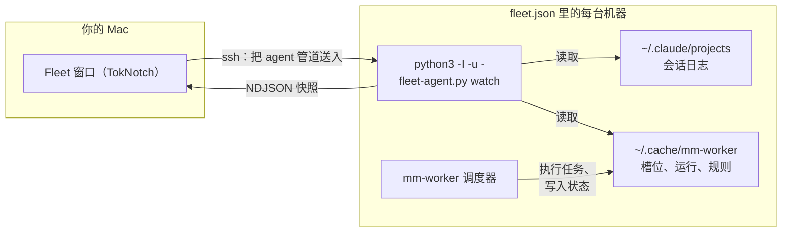

# Fleet

Fleet 是本 fork 在原版 TokNotch 之上增加的功能。TokNotch 常驻屏幕边缘，显示一台
Mac 上各个 AI 套餐的回本情况；Fleet 把这件事扩展到多台机器：一个窗口，盯着你列出
的每台机器上的 agent——它们的 Claude Code 会话、`mm-worker` 任务、今日 token——
并且在一个地方修改每台机器的派活规则。

它适合在多台机器上跑编码 agent 的人：一台 Mac 加一台 Linux 工作站、柜子里的一台
无头主机、架子上一块开发板。被监控的机器什么都不用装；Mac 关机之后，各台机器照样
干活。

派活规则本身和磁盘上的状态布局在 [FLEET-RULES.md](FLEET-RULES.md) 里有完整规定，
本页只做链接，不再重复。英文版指南见 [FLEET.md](FLEET.md)。

## 特性

- **总览页** —— 跨机器汇总：多少台在线、活跃会话、运行中的 worker、今日
  token；每台机器一张卡片；各提供商合计，并可对照账户上限。
- **单台机器的页面** —— 在线状态、CPU 占用、负载、CPU 温度、今日各模型
  token、以及这台机器上的会话。不做 GPU 监控。
- **用量页面** —— 跨机器、跨账户的 token 用量，范围有今日、7 天、30 天，可按机器、
  账户或模型查看，也可不计缓存读取：总量、与上一周期的对比、每日堆叠柱状图和可
  展开的明细。历史数据缓存在 Mac 上，离线的机器仍会计入，并标明最后上报时间。
  见 [FLEET-USAGE.md](FLEET-USAGE.md)。
- **worker 实时进度** —— 名称、提供商、模型、步数、当前工具、最后改动的文件、
  token、已多久无输出。停止按钮带确认。
- **每台机器的规则编辑器** —— 各提供商的启用开关、槽位、每个任务级别用的模型、
  均衡方式、提供商顺序、默认超时、冷却时间，以及恢复默认。会覆盖别人修改的保存
  会被拒绝。
- **从应用安装或更新调度器** —— 把内置的 `mm-worker.py` 通过 ssh 送到
  `~/.local/bin/mm-worker`。
- **提供商合计与账户上限** —— 每个提供商的运行数、槽位跨机器相加，可以给每个
  账户设一个上限，超过时给出警告。但也只是警告：每台机器只限制自己，没有任何
  机制跨机器执行这个上限。
- **mm-worker** —— 一个 Python 调度器，把 Claude Code 任务派到多个提供商上：
  任务分级、每提供商槽位、带冷却的故障转移，以及用 `-H` 把任务送到另一台机器。
- **远程用量同步** —— 一个按钮，运行你自己的 `~/bin/tokscale-remote-sync`
  脚本（如果有的话），让环形图把其他机器的用量也算进来。

## 工作原理

TokNotch 在每条 ssh 连接里把一个小 agent——`fleet-agent.py`——用管道送进
`python3 -I -u -`。这个 agent 读取 Claude Code 的会话日志和 mm-worker 的状态
目录，每行输出一个 JSON 快照。被监控的机器不需要安装任何东西，而且 agent 永远
和应用匹配，因为是应用自带副本。连接断开后，agent 的下一次写入失败，它就自己
退出。



- **监控不需要安装任何东西。** agent 从标准输入进入，用 `-I` 运行，Python 不会
  从远端家目录导入任何东西。
- **连接只在窗口打开时存在。** 打开 Fleet 窗口就建立连接，关掉就断开。没人看
  的机器不会被叨扰。
- **命令都是一次性的连接。** 停止 worker、保存或恢复规则、安装调度器，各自跑
  一条命令就结束，不是长驻的监控。
- **每台机器的规则放在那台机器上**，也就是 `~/.config/mm-worker/rules.json`。
  运行时没有任何东西协调各台机器，所以 Mac 关机后机器照常派活。见
  [FLEET-RULES.md](FLEET-RULES.md)。

ssh 连接使用 `BatchMode`，永远不会停下来等输密码：没有配好免密登录的机器会显示
为离线。

## 环境要求

**你的 Mac**

- macOS 14 (Sonoma) 或更新版本。
- Python 3，监控这台 Mac 本身时要用。应用会在常用的位置（包括 Homebrew）寻找
  `python3`。
- 编译需要 Xcode 和 [xcodegen](https://github.com/yonaskolb/XcodeGen)。本 fork
  在 macOS 15.6.1 上用 Xcode 26.6 构建并测试过。

**你添加的每台机器**

- Linux 或 macOS。
- Python 3.9 或更新版本。仅此而已：agent 只用标准库。
- 从你的 Mac 能用密钥登录 ssh（以 TokNotch 连接的用户身份）。永远不会弹出输密码
  的提示。
- 要在那台机器上跑 `mm-worker` 任务：需要装好 Claude Code 并已登录。

## 从源码构建与安装

本 fork 没有发布版。想要 Fleet，只能从源码构建。

```sh
brew install xcodegen
make run
```

首次构建会拉取固定的 tokscale 二进制并生成 Xcode 工程，然后启动一个 Debug 构建。
`make test` 跑 Swift 测试套件，包括需要图形界面的那部分。Python 套件单独运行——见[测试](#测试)。

`make install` 会构建一个 Release 版直接装进 `/Applications`，但用的是**上游
作者**的 Developer ID 签名。那个签名不是你的，对其他任何人都不可用；本 fork 自己
没有签名身份。

## 配置

### 机器清单

机器列表在你的 Mac 的 `~/.config/toknotch/fleet.json` 里，在仓库之外，所以机器
名字不会进入源码。没有这个文件——或者文件读不出来、`devices` 为空——fleet 就只有
这台 Mac。一旦列出设备，这个默认就没有了，所以如果还想看到本机，要给它留一个
`ssh` 为空列表的条目。

```json
{
  "devices": [
    { "id": "local", "label": "This Mac", "ssh": [] },
    {
      "id": "workstation",
      "label": "Workstation",
      "ssh": ["workstation", "workstation-vpn"]
    },
    {
      "id": "raspberry",
      "label": "Board",
      "ssh": ["raspberry"],
      "sudoUser": "agentuser"
    }
  ],
  "accountLimits": { "minimax": 10, "zhipu": 4 }
}
```

| 字段 | 含义 |
|---|---|
| `id` | 机器的唯一名字，内部使用。 |
| `label` | 窗口里显示的名字。可省略，默认用 `id`。 |
| `ssh` | ssh 别名（来自你的 `~/.ssh/config`），按顺序尝试。为空表示这台 Mac。失败后应用会换下一个别名，然后退避重试。 |
| `sudoUser` | 通过免密 sudo（`sudo -n -u … -H`）读取另一个账户的数据。它的规则随之变为只读。 |
| `accountLimits` | 每个提供商账户允许的最大槽位数。正整数；只用于合计警告。 |

手工编辑这个文件后需要重启应用才生效。唯一的例外是账户上限：在窗口的「提供商
合计」表格里填的上限由应用写回这个文件，立即生效。

### 提供商密钥

`mm-worker` 从真正执行任务的那台机器上读取各提供商的主机和密钥，文件格式是每行
一条 `NAME=value`：

| 提供商 | 文件 | 变量 |
|---|---|---|
| MiniMax | `~/.config/minimax/env` | `MINIMAX_API_HOST`、`MINIMAX_API_KEY` |
| 智谱 | `~/.config/zhipu/env` | `ZHIPU_API_HOST`、`ZHIPU_API_KEY` |
| 千问 | `~/.config/qwen/env` | `QWEN_API_HOST`、`QWEN_API_KEY` |
| Claude | — | 无文件。那台机器上要装好 Claude Code 并已登录。 |

每个文件还可以覆盖别名对应的模型（`MM_OPUS`、`MM_SONNET`、`MM_HAIKU`、
`ZP_OPUS`、`ZP_SONNET`、`ZP_HAIKU`、`ZP_SUBAGENT`、`QW_OPUS`、`QW_SONNET`、
`QW_HAIKU`、`QW_MAX_OUTPUT`、`QW_SUBAGENT`）；用法见 `Sources/Resources/mm-worker.py`
里的 `provider_env()`。

Fleet 从不读取、复制或显示这些值——见[安全与隐私](#安全与隐私)。

## 使用 Fleet 窗口

### 打开窗口

下面这些方式打开的是同一个窗口：

- 设置窗口——侧栏页面列表末尾的「**设备与 Agent…**」一行；
- 右键点 Dock 图标（如果 TokNotch 在 Dock 里）；
- 应用菜单——「**设备与 Agent…**」，快捷键 ⇧⌘F；
- 菜单栏图标的面板——「**设备与 Agent…**」一行；
- 刘海（notch）的右键菜单——「**设备与 Agent…**」一项。

打开窗口即建立连接，关掉即断开。没保存的规则修改在窗口关闭后仍然保留。

### 总览页

第一页汇总整个 fleet：在线台数、活跃会话、运行中的 worker、今日 token。每台
机器一张卡片，带着它的状态、CPU 占用、温度和自己的三个数字；点卡片进入它的
页面。卡片下面是「**提供商合计**」，把每个提供商跨机器相加——运行数、配置的
槽位，以及可以在这里填写的账户上限——槽位加起来超过上限时会给出警告。

### 单台机器的页面

页头显示机器名字、主机名、系统和架构、负载，以及这次报告走的是哪个 ssh 别名
——或者离线的原因和最后在线时间。往下是：

- **数字块** —— CPU 占用和温度（升高时会变色）、今日 token、活跃会话、运行中
  worker。
- **今日各模型用量** —— 每个模型一条横条，按今日 token 占比定宽。悬停显示输入、
  输出、缓存读、缓存写。
- **Worker** —— `mm-worker` 的每个正在运行或刚结束的任务一行：用 `-n` 起的
  名字、提供商、模型、状态、进行到第几步、当前工具和最后改动的文件、token、
  已运行时长。安静了五分钟的 worker 会注明。停止按钮先确认：「停止这个
  worker？」——被停止的任务不会换一个提供商重跑，工作区可能留下改了一半的
  内容。从这台机器派到别处的任务列在真正执行它的那台机器上，所以只被统计一次，
  也只能在那里停止。
- **会话** —— 最近六小时的 Claude Code 会话，交互的和 worker 的都有，最近
  活动在最前：标题或项目文件夹、类型、模型、当前工具、token，以及是否活跃。
- **派活规则** —— 即下一节介绍的编辑器。

### 派活规则

每台机器页面末尾的规则编辑器，编辑那台机器的
`~/.config/mm-worker/rules.json`。各字段的含义在
[FLEET-RULES.md](FLEET-RULES.md) 中规定；编辑器边输入边校验，机器会拒绝的内容
就保存不了。

- **提供商** —— 每个提供商一个开关和一个槽位步进器，并显示正在使用的槽位数、
  那台机器上是否配置了密钥，以及冷却中的原因。
- **各级别使用的模型** —— 每个级别 × 每个提供商一个菜单；选「不使用」就把该
  提供商排除在这个级别之外。菜单列出提供商 API 返回的全部模型，打开规则时读取一次，
  也可以手动刷新；Claude 订阅没有可用来查询的密钥，所以用内置列表。账户用不了的模型不显示，比如 GLM
  Coding Plan 的 `glm-5.3-flashx`。需要那台机器的
  `mm-worker` 是第 2 版或更新。某个级别下面没有任何启用的提供商时会明确指出，
  因为这时只有直接指定提供商的任务才能跑。
- **Agent CLI** —— `claude` 或 `opencode`，后者用于通过 opencode 运行 MiniMax、智谱
  或千问、不用 Claude 的机器。详见 `docs/FLEET-RULES.md`。
- **均衡方式** —— 「按比例」（选占用槽位比例最小的提供商，相同时按顺序）或
  「按优先级」（按顺序选第一个有空闲槽位的提供商）。
- **提供商顺序** —— 上移、下移。
- **默认超时**和**冷却时间**，单位秒。
- **保存**、**还原**，以及会先确认的「**恢复默认…**」。

如果你开始编辑之后那台机器上的规则又被改过——比如别人或另一台 Mac 改的——保存
会被拒绝。窗口会说明情况，显示最新规则，你输入的内容不再保留；重新改一遍再保存。
离线的机器显示最后已知的规则，未保存的修改会保留到机器恢复。通过他人的 sudo
读取的账户全程只读。

表单上方是调度器自身的状态——未安装、版本较旧、已是最新、或比此应用更新——
并配有「**安装…**」或「**更新…**」按钮，把内置的 `mm-worker.py` 通过 ssh 送到
`~/.local/bin/mm-worker`。文件会先核对字节数再改名就位，所以连接断开也不会装上
半个调度器；已经在运行的调度器继续用它启动时的那份旧文件，直到退出。

## mm-worker 用法

`mm-worker` 在多个提供商上运行一个非交互的 Claude Code 任务，按任务级别和负载
选择提供商，某个提供商配额用尽或失败时换下一个。它只用标准库，Python 3.9 或
更新版本，Linux 和 macOS。完整契约——规则格式和状态布局——见
[FLEET-RULES.md](FLEET-RULES.md)。

### 常用命令

```sh
# 跑一个任务，按级别和负载挑提供商
mm-worker "修好失败的测试"

# 起个名字（在 Fleet 里好认），较长的提示词从文件读
mm-worker -n "api-client" -l hard -f task.md

# 用管道送提示词
echo "总结这些笔记" | mm-worker

# 强制某个提供商，已停用的也可以
mm-worker -b zhipu "重构缓存模块"

# 看这台机器现在会用什么、谁在冷却、最近 15 次运行
mm-worker --status

# 把任务送到另一台机器；连接断了它也会继续跑
mm-worker -H workstation -n "bench" "给解析器做基准测试"

# 事后凭 mm-worker 打印的运行 id 取结果或取消
mm-worker --fetch 20260612-101502-4311
mm-worker --kill 20260612-101502-4311
```

提示词可以来自参数、`-f 文件`或标准输入。`--` 之后的所有参数原样传给 Claude Code。

### 退出码

| 退出码 | 含义 |
|---|---|
| `0` | 成功 |
| `2` | 用法错误：级别不存在、提示词缺失或为空，或者用 `-H` 时目标机器连不上、缺 `mm-remote-run` |
| `3` | 被拒绝：`mm-worker` 是在另一个 worker 里启动的；不允许嵌套派活 |
| `124` | 单次运行超时（远程超时同样报 `124`） |
| `127` | 找不到 Claude Code（本地运行） |
| `130` | 已取消或被中断；该任务不会换提供商重跑 |
| 其他 | 失败；自动派活时任务会换下一个提供商 |

### 选项

| 选项 | 含义 |
|---|---|
| `-l, --level simple\|normal\|hard` | 任务级别（默认 `normal`，配 `-m fast` 时为 `simple`） |
| `-b, -P, --backend auto\|minimax\|zhipu\|claude\|qwen` | 强制某个提供商，已停用的也可以（默认 `auto`） |
| `-m, --mm-model m3\|m27\|fast\|完整模型名` | MiniMax 模型 |
| `-z, --zp-model flash\|完整模型名` | 智谱模型 |
| `--cli claude\|opencode` | 运行 worker 的 agent，仅限本机 |
| `-q, --qw-model glm\|max\|flash\|lite\|ds` | 千问端点模型 |
| `-c, --claude-model MODEL` | Claude 模型（opus 只用于 hard） |
| `-t, --timeout SEC` | 单次运行超时（默认取自规则） |
| `-n, --name NAME` | 在 Fleet 里显示的任务名 |
| `-f FILE` | 从文件读提示词 |
| `-H, --host HOST` | 把 worker 放到另一台机器上运行 |
| `-C, --rdir DIR` | 对方机器上的工作目录（默认：当前目录，相对于家目录） |
| `--json` | 输出原始结果事件而不是其文本 |
| `--status` | 显示冷却、槽位和最近运行 |
| `--fetch RUN_ID` | 取回送到另一台机器的任务结果 |
| `--kill RUN_ID` | 取消送到另一台机器的任务 |
| `-h, --help` | 用法说明 |

`-H`、`-C`、`-c` 的默认值分别来自环境变量 `MM_WORKER_HOST`、`MM_WORKER_RDIR`、
`MM_WORKER_CLAUDE_MODEL`。槽位、冷却、轮询间隔、目标失联时等多久，也可以用环境
变量覆盖（`MM_WORKER_SLOTS_<PROVIDER>`、`MM_WORKER_COOLDOWN`、
`MM_WORKER_POLL`、`MM_WORKER_OFFLINE_WAIT`）；见 `mm-worker.py` 开头。

本机没有配置密钥的提供商会跳过自动派活；用 `-b` 仍然可以强制用它，这是有意留的
后门。

### 把任务送到另一台机器

`-H host` 通过 ssh 把任务送到 `host`，并在本机这边盯着它。提示词和名字（如果
给了）会复制到目标机器的
`~/.cache/mm-worker/jobs/<运行 id>-<提供商>/`，任务以脱离连接的方式启动，所以
连接断开——甚至这台机器关机——都不会让它停下。目标失联时 `mm-worker` 会不断
重试，告诉你之后如何 `--fetch` 或 `--kill`，能连上时就把结果取回来。此时按
**目标**机器的槽位、规则、key 和冷却状态计算，任务占目标机器的槽，不占本机的；见
[FLEET-RULES.md](FLEET-RULES.md)。

`-H` 需要目标机器上有一个配套脚本 `~/.local/bin/mm-remote-run`，**而这个脚本不
在本仓库里**——需要自己手工配置。没有它，`mm-worker -H` 会以退出码 2 结束，提示
目标连不上或缺少该脚本。mm-worker 先确认脚本存在、可执行、工作目录存在、目标有 `python3`，然后在目标上等到
空槽，以脱离终端的方式运行：

```
.local/bin/mm-remote-run <提供商> <超时秒数> <工作目录> \
    --model <模型别名> -p --output-format stream-json --verbose \
    [其余 Claude Code 参数...]
```

提示词来自标准输入。这个脚本必须：

1. 在第三个参数指定的工作目录里干活；
2. 按本地 worker 同样的方式准备好该提供商的环境——读取那台机器的
   `~/.config/<提供商>/env`，用主机和密钥变量设置 `ANTHROPIC_BASE_URL` 和
   `ANTHROPIC_AUTH_TOKEN`，并让 `--model` 的别名经过 `ANTHROPIC_DEFAULT_*_MODEL`
   变量落到该提供商自己的模型上。`mm-worker.py` 里的 `provider_env()` 就是参照
   实现；
3. 带着收到的参数在工作目录里非交互地运行 Claude Code，并原样传递退出码；
4. 把 stream-json 事件流写到标准输出——Fleet 靠它看进度——诊断信息写到标准
   错误。

mm-worker 把标准输出收进任务目录，运行结束时只保留最后一个事件，并记录退出码。
注意 `--model` 收到的是 Claude 模型别名（`opus[1m]`、`sonnet`、`haiku` 等），
由上面第 2 条的环境落到各提供商自己的模型上——和本地运行完全一致。

## 安全与隐私

agent 自己的说明是：`watch` 和 `--once` 是只读的。它们报告 token 数量、模型名、
工具名、worker 最后改动的文件名，以及每个会话或 worker 的简短标题。它们从不
上报消息正文、命令或其他工具输入，也不上报任何凭据文件的内容——凭据文件只在
判断「是否设置了密钥」时被读取。

- **agent 只检查密钥是否设置。** 它读取密钥文件，只为确认
  `~/.config/<提供商>/env` 里的密钥变量是否非空并上报布尔值；窗口里显示
  「已配置」或「这台机器上没有密钥」。密钥永远不会被复制到你的 Mac，也不会被
  显示。
- **会上报账户名称。** 为了按付费账户归类 token，agent 会上报系统账户名，以及
  `~/.claude.json` 里 `oauthAccount` 的 Claude 邮箱、套餐名和组织名，这个文件的
  其他内容不会上报。这些信息经你的 ssh 传回，显示在窗口里，并保存在你 Mac 上的
  `~/Library/Application Support/TokNotch/fleet-usage.json`。
- **`sudoUser` 只读。** 通过他人的 sudo 读取的账户，不能从窗口停止它的 worker、
  修改它的规则或安装调度器。
- **会写入远端机器的操作只有三种**：停止它的一个 worker、保存或恢复它的规则、
  安装调度器。Fleet 在机器上做的其余一切都是读取。
- **上游「什么都不外传」的说法需要这个限定**：Fleet 会通过你自己的 ssh，与你
  在 `fleet.json` 里列出的机器通信——也仅限这些机器。流量走的是你早已配置好的
  ssh 和你本来就在用的密钥。另外，本 fork 移除了上游的用量心跳。

## 测试

截至 `ef0603f`：

```sh
python3 Tests/fleet_agent_test.py     # 85 项，全部通过
python3 Tests/mm_worker_test.py       # 88 项；Linux 上全部通过
make test                             # Swift 套件，见下
```

- `mm_worker_test.py` 的 `--kill` 测试依赖 `pkill -s`，macOS 上不支持，所以在 macOS
  上跳过这一项；其余测试通过。
- Swift 逻辑测试 199 项通过。它们是经 ssh 用一个小运行器跑的，不是 `make test`。
- 应用与测试目标均可编译。
- 托管 GUI 的 XCTest **没有**运行：它们需要图形登录会话，而通过 ssh 连到的测试
  机没有。
- 真实任务在三个提供商上跑过，本地和远程都有，包括一次取消。调度器在四台远程
  机器上安装过；在其中一台机器上，通过应用的存储代码验证了保存、冲突时拒绝
  保存和恢复默认。

## 已知限制

直说：

- **窗口里的控件没有人在真实会话里点过**——真人没有，自动化也没有。停止按钮、
  规则编辑器、确认对话框、安装按钮都没有手工测过。它们底下的逻辑在真实机器上
  通过存储代码测过。
- **用量页面是用渲染图和真实日志检查的，没有人工操作过。** 悬停、点击展开和动画
  都没有在真实会话里试过。历史扫描只在 Mac 和 Linux 机器上实测过，没有在树莓派
  这类小型设备上测过。
- **主机名和系统账户都相同的两台机器，在用量页面上算一台**，因为看起来就是同一份
  日志列了两次。
- **用量页面分不清同一厂商的不同 API key**，所以 MiniMax、智谱每家一行，不管用了
  几个 key。
- **关闭窗口**以及随之而来的连接清理，没有在真实应用里核对过。
- **刘海右键菜单入口对一位用户不起作用**，原因没有查明。设置侧栏那一行是可靠
  的入口。
- **Claude Code 只是装好了就会显示「已配置」。** 应用看不到过期的登录，所以在
  那台机器上有人运行 `claude` 并执行 `/login` 之前，这个提供商上的任务会失败。
- **只有英文、简体中文和繁体中文翻译了 Fleet 的文字。** 其余十三种语言显示
  英文。
- **用 `-H` 时，目标机器的规则 `cli` 不生效**：任务总是在 `claude` 下运行，和 `mm-remote-run` 一样。
- **会话和 worker 列表只读 `~/.claude/projects` 下的 Claude Code 日志。**
  会话和 worker 都是从 Claude Code 自己的会话日志认出来的——`claude` 命令行
  以及任何驱动它的工具，包括 `mm-worker` 任务。token 统计还会读 opencode 的数据库，
  所以 opencode 的 token 会按机器、按模型显示，但它的会话不会列出。两者都不写的其他
  编码工具，在 Fleet 的单机数字里看不到，即使刘海的圆环统计到了它们的 token。
- **`make install` 用的是上游作者的 Developer ID**（见上文），而且**本 fork 没有
  发布版、也没有自动更新**：本 fork 的构建里移除了更新源地址（`SUFeedURL`），
  所以 Sparkle 不会启动，也不会把你的构建替换成上游的发布版。

## 故障排查

| 现象 | 含义 |
|---|---|
| 某台机器显示「离线：……」 | ssh 连不上，或者连上了却没了回应。先确认这台 Mac 能用密钥登录——Fleet 永远不会应答密码提示。它会一直重试，并轮流尝试各个别名。 |
| 「调度器较旧：版本 N」/「shell 版本」 | 那台机器的 `~/.local/bin/mm-worker` 比本应用的副本旧。在规则一节里用「更新…」。 |
| 「规则已在别处被修改，你的修改没有保存。」 | 别人先保存了那台机器的规则。现在显示的是最新规则；重新改一遍再保存。 |
| 「这台机器的 rules.json 无效，mm-worker 正在使用这里显示的默认值。」 | 那台机器上的文件没有通过校验。但什么都没有停：`mm-worker` 会在标准错误上警告并使用默认值。保存会替换该文件。 |
| 提供商旁边显示「冷却中：……」 | 它最近失败过——配额用尽或被限流——`mm-worker` 在冷却结束前不去动它。自动派活会跳过它。 |

## 代码位置

| 路径 | 内容 |
|---|---|
| `Sources/Fleet/FleetView.swift` | 窗口本体：总览、机器页面、worker 和会话行 |
| `Sources/Fleet/FleetRulesView.swift` | 规则编辑器和提供商合计表格 |
| `Sources/Fleet/FleetStore.swift` | 设备状态；保存、恢复、安装、停止等动作；合计 |
| `Sources/Fleet/FleetConnection.swift` | ssh 传输：agent 生命周期、看门狗、一次性命令 |
| `Sources/Fleet/FleetModels.swift` | 快照、设备等类型；`fleet.json` 的读写 |
| `Sources/Fleet/FleetUsage.swift`、`Sources/Fleet/FleetUsageView.swift` | 用量页面：归类、缓存和界面 |
| `Sources/Fleet/FleetRules.swift` | 规则校验、默认值、调度器状态 |
| `Sources/Fleet/FleetWindowController.swift` | 窗口本身；建立和断开连接 |
| `Sources/Resources/fleet-agent.py` | 通过 ssh 管道送入的 agent |
| `Sources/Resources/mm-worker.py` | 装在每台机器上的调度器 |
| `Tests/FleetTests.swift` | 以上各项的 Swift 测试 |
| `Tests/fleet_agent_test.py`、`Tests/mm_worker_test.py` | Python 测试套件 |
| `Tests/RemoteSyncTests.swift` | 远程用量同步的测试 |
| [FLEET-USAGE.md](FLEET-USAGE.md) | 用量历史契约和归类规则 |
| [FLEET-RULES.md](FLEET-RULES.md) | 规则与状态布局契约 |
| [ARCHITECTURE.md](ARCHITECTURE.md) | Fleet 在应用中的位置 |
